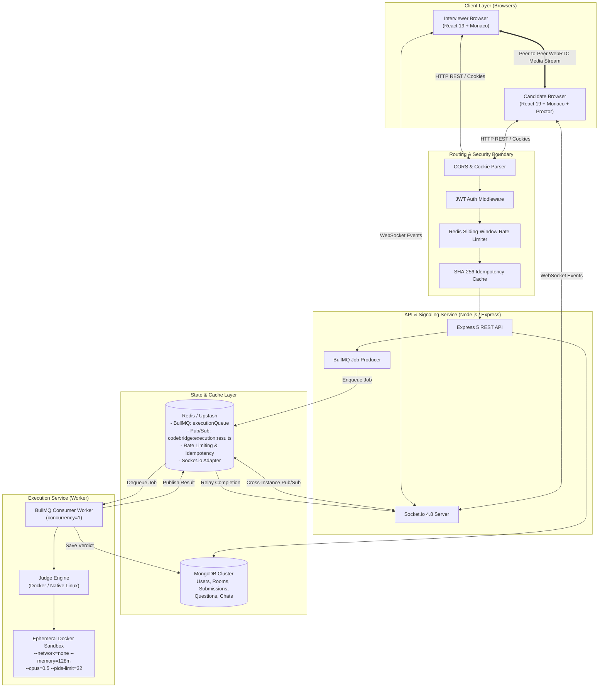
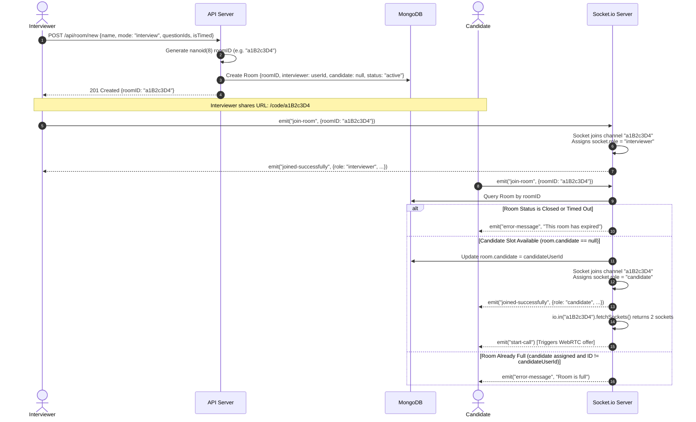
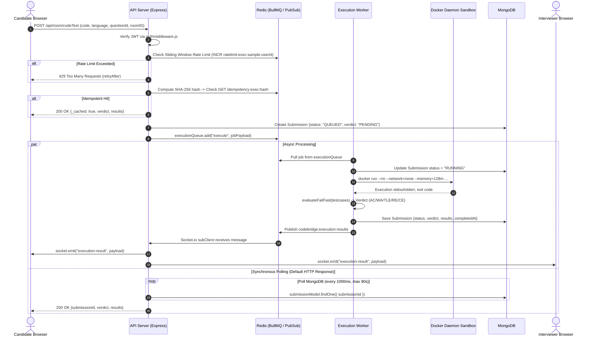
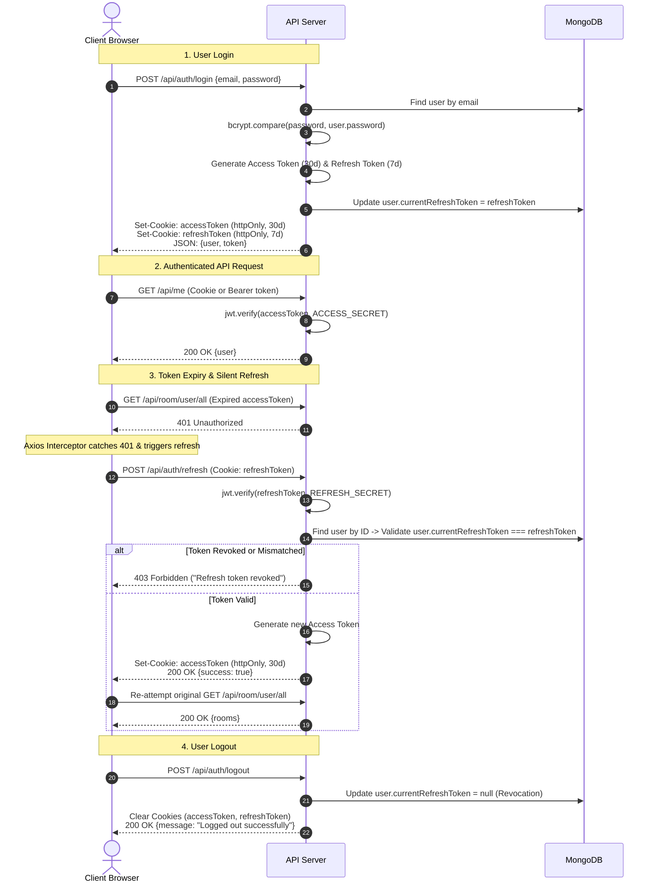
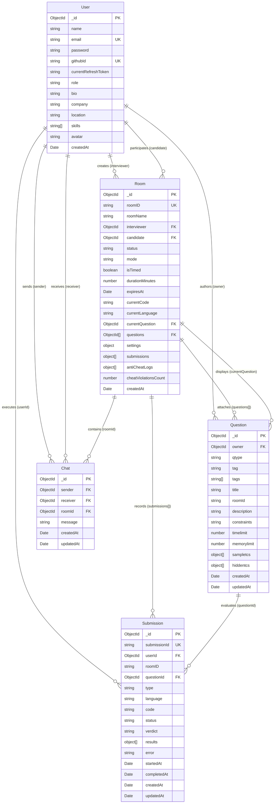

# 🌉 CodeBridge — Complete Technical Reference & Interview Preparation Guide

> **A distributed, real-time technical interview platform featuring sandboxed multi-language code execution, low-latency WebRTC peer-to-peer video/audio, bi-directional code synchronization, and an observable proctoring engine.**

---

## 📋 Table of Contents

- [A. Project Overview & Interview Pitch](#a-project-overview--interview-pitch)
  - [Problem Statement & Target Users](#problem-statement--target-users)
  - [Core Capabilities & Architectural Decisions](#core-capabilities--architectural-decisions)
  - [60-Second Elevator Pitch](#60-second-elevator-pitch)
  - [2–3-Minute Technical Walkthrough](#23-minute-technical-walkthrough)
- [B. Complete System Architecture](#b-complete-system-architecture)
  - [High-Level System Topology](#high-level-system-topology)
  - [Frontend-to-Backend Request Lifecycle](#frontend-to-backend-request-lifecycle)
  - [Room Creation & Participant Admission Lifecycle](#room-creation--participant-admission-lifecycle)
  - [Real-Time Code Synchronization](#real-time-code-synchronization)
  - [WebRTC Signaling & P2P Media Streaming](#webrtc-signaling--p2p-media-streaming)
  - [Code Submission & Execution Lifecycle](#code-submission--execution-lifecycle)
  - [Queue & Worker Inter-Process Communication](#queue--worker-inter-process-communication)
  - [MongoDB Persistence Layer](#mongodb-persistence-layer)
  - [Authentication & Refresh-Token Lifecycle](#authentication--refresh-token-lifecycle)
- [C. Frontend Architecture](#c-frontend-architecture)
  - [React 19 & Vite Structure](#react-19--vite-structure)
  - [Routing & Protected Routes](#routing--protected-routes)
  - [Authentication State Management](#authentication-state-management)
  - [API Client & Token Refresh Interceptors](#api-client--token-refresh-interceptors)
  - [Socket.io Client Lifecycle](#socketio-client-lifecycle)
  - [Monaco Editor Integration](#monaco-editor-integration)
  - [WebRTC Peer Connections & ICE Signaling](#webrtc-peer-connections--ice-signaling)
  - [Proctoring Event Detection & Observability](#proctoring-event-detection--observability)
- [D. Backend Architecture](#d-backend-architecture)
  - [Server Initialization & Middleware Order](#server-initialization--middleware-order)
  - [Controller & Service Separation](#controller--service-separation)
  - [Authentication & Authorization Pipeline](#authentication--authorization-pipeline)
  - [Room Lifecycle Management](#room-lifecycle-management)
  - [Question Bank Management & Ingestion](#question-bank-management--ingestion)
  - [Socket.io Event Dispatcher](#socketio-event-dispatcher)
  - [BullMQ Job Producer](#bullmq-job-producer)
  - [Execution Service Worker Process](#execution-service-worker-process)
  - [Error Handling & API Responses](#error-handling--api-responses)
- [E. Code-Execution Engine & Sandboxing](#e-code-execution-engine--sandboxing)
  - [Sample Runs vs. Hidden Submissions](#sample-runs-vs-hidden-submissions)
  - [Multi-Language Runtime Configuration](#multi-language-runtime-configuration)
  - [Docker Sandbox Hardening & Resource Constraints](#docker-sandbox-hardening--resource-constraints)
  - [Watchdog Timeouts, Output Buffering & Verdict Logic](#watchdog-timeouts-output-buffering--verdict-logic)
  - [Queue Concurrency, Backoff & Error Handling](#queue-concurrency-backoff--error-handling)
  - [Native Linux Fallback Runner](#native-linux-fallback-runner)
  - [Security Boundaries & Potential Attack Vectors](#security-boundaries--potential-attack-vectors)
- [F. Authentication & Security](#f-authentication--security)
  - [Password Hashing with Argon2 / bcrypt](#password-hashing-with-argon2--bcrypt)
  - [Dual JWT Architecture & Cookie Policies](#dual-jwt-architecture--cookie-policies)
  - [Server-Side Refresh-Token Revocation](#server-side-refresh-token-revocation)
  - [GitHub OAuth 2.0 Integration](#github-oauth-20-integration)
  - [CORS & Input Sanitization](#cors--input-sanitization)
  - [Sliding-Window Rate Limiting](#sliding-window-rate-limiting)
  - [SHA-256 Idempotency Cache](#sha-256-idempotency-cache)
  - [Proctoring Audit Logging](#proctoring-audit-logging)
- [G. Data Model & Complete API Reference](#g-data-model--complete-api-reference)
  - [Entity Relationship Diagram](#entity-relationship-diagram)
  - [Mongoose Schemas & Model Specifications](#mongoose-schemas--model-specifications)
  - [Data Lifecycle & Integrity Rules](#data-lifecycle--integrity-rules)
  - [REST API Reference](#rest-api-reference)
  - [Socket.io Event Map](#socketio-event-map)
- [H. Redis, Distributed Execution & Scalability](#h-redis-distributed-execution--scalability)
  - [BullMQ Architecture & Key Namespaces](#bullmq-architecture--key-namespaces)
  - [Redis Pub/Sub & Socket.io Adapter](#redis-pubsub--socketio-adapter)
  - [Sliding-Window Rate Limiter Engine](#sliding-window-rate-limiter-engine)
  - [Idempotency Caching & TTL Dynamics](#idempotency-caching--ttl-dynamics)
  - [Redis Failure Handling & Circuit Breakers](#redis-failure-handling--circuit-breakers)
  - [Horizontal Scaling Limitations & Process-Local State](#horizontal-scaling-limitations--process-local-state)
- [I. Setup, Deployment & Debugging](#i-setup-deployment--debugging)
  - [Local Development Setup](#local-development-setup)
  - [Environment Variables Reference](#environment-variables-reference)
  - [Docker Compose Multi-Container Orchestration](#docker-compose-multi-container-orchestration)
  - [AWS EC2 Dedicated Worker Setup](#aws-ec2-dedicated-worker-setup)
  - [Render Deployment (API + Fallback Worker)](#render-deployment-api--fallback-worker)
  - [Diagnostics & Operational Troubleshooting](#diagnostics--operational-troubleshooting)
- [J. Technical Trade-Offs & Limitations](#j-technical-trade-offs--limitations)
  - [Full-Buffer Sync vs. OT / CRDTs](#full-buffer-sync-vs-ot--crdts)
  - [Synchronous HTTP Polling vs. Event-Driven WebSockets](#synchronous-http-polling-vs-event-driven-websockets)
  - [STUN-Only WebRTC vs. Managed TURN Relay](#stun-only-webrtc-vs-managed-turn-relay)
  - [In-Memory Timers vs. Distributed Schedulers](#in-memory-timers-vs-distributed-schedulers)
  - [Docker Sandbox vs. Native Host Fallback](#docker-sandbox-vs-native-host-fallback)
  - [Client-Side Proctoring Signals vs. Physical Proctoring](#client-side-proctoring-signals-vs-physical-proctoring)
  - [Automated Testing & Observability Gaps](#automated-testing--observability-gaps)
- [K. Interview Preparation Question Bank](#k-interview-preparation-question-bank)
  - [System Architecture & Design Questions](#system-architecture--design-questions)
  - [Backend & API Implementation Questions](#backend--api-implementation-questions)
  - [Redis, Queues & Distributed Systems Questions](#redis-queues--distributed-systems-questions)
  - [Operating System, Processes & Sandboxing Questions](#operating-system-processes--sandboxing-questions)
  - [WebRTC & Real-Time Communication Questions](#webrtc--real-time-communication-questions)
  - [Database & Authentication Questions](#database--authentication-questions)
  - [Security, Failure Scenarios & Debugging Questions](#security-failure-scenarios--debugging-questions)
- [L. Source-File Study Guide](#l-source-file-study-guide)

---

## A. Project Overview & Interview Pitch

### Problem Statement & Target Users

Live technical interviews present three core engineering challenges:
1. **Host Security Vulnerabilities in Code Execution**: Running arbitrary code written by candidates directly on application servers invites Remote Code Execution (RCE), fork bombs, infinite loops, and Server-Side Request Forgery (SSRF).
2. **Real-Time Node.js Event Loop Congestion**: If a Node.js process handles compilation, process spawning, WebSocket broadcasting, and WebRTC signaling simultaneously, heavy CPU-bound compilation tasks block the single-threaded event loop, introducing packet latency and dropping peer media frames.
3. **Assessment Integrity Evasion**: Basic web proctoring solutions rely on easily disabled client-side alerts that fail to create server-persisted audit trails for interviewers.

**CodeBridge** is an open-source technical interview platform designed for hiring engineers, technical recruiters, and candidates. It addresses these challenges through a distributed architecture that decouples API signaling from untrusted code execution using dedicated background workers and containerized sandboxes.

### Core Capabilities & Architectural Decisions

- **Decoupled Architecture**: Separates the client-facing API gateway ([server/](server/)) from the compute-intensive execution engine ([execution-service/](execution-service/)) using a Redis-backed queue ([BullMQ](https://bullmq.io/)).
- **Multi-Layer Container Sandboxing**: Evaluates candidate code in isolated Docker containers configured with `--network=none`, `--memory=128m`, `--cpus=0.5`, `--pids-limit=32`, and an immutable read-only root filesystem.
- **Bi-Directional Monaco Code Sync**: Synchronizes code across room participants in real time over Socket.io WebSockets.
- **Direct P2P WebRTC Audio/Video**: Implements camera, microphone, and screen-sharing streams using the browser's native `RTCPeerConnection` API and public STUN servers.
- **Fail-Fast Sequential Judge**: Halts execution at the first failing test case to conserve worker CPU time and provide rapid feedback.
- **Integrity Auditing**: Logs browser focus events, tab visibility changes, DevTools keybindings, and large clipboard pastes to MongoDB, alerting the interviewer in real time.
- **Dual-Token Authentication**: Combines 30-day access cookies with database-validated 7-day refresh tokens supporting explicit revocation upon logout, along with GitHub OAuth 2.0.

### 60-Second Elevator Pitch

> *"CodeBridge is a distributed technical interview platform built with Node.js, Express, React 19, MongoDB, and Redis. It decouples real-time communication from untrusted code execution using BullMQ and isolated Docker sandboxes. When a candidate runs code, the API server applies Redis sliding-window rate limiting and SHA-256 idempotency deduplication before enqueuing the task. A dedicated execution worker pulls the job and runs it inside a hardened container constrained to 128MB of RAM, half a CPU core, 32 process IDs, and zero network access. Meanwhile, interviewers and candidates collaborate through a synchronized Monaco editor and native WebRTC video. Any candidate focus loss, fullscreen exit, or devtool shortcut is captured and persisted to MongoDB for audit review."*

### 2–3-Minute Technical Walkthrough

> *"When architecting CodeBridge, my primary objective was to ensure that executing arbitrary candidate code could never compromise host security or degrade real-time video and editor performance.*
>
> *I split the system into two independent services communicating via Redis and MongoDB:*
> 1. *The **API Service** manages HTTP routing, dual-token JWT authentication (with server-side revocation on logout), WebRTC signaling, and WebSocket rooms. We use `@socket.io/redis-adapter` so room events scale horizontally across multiple Node.js instances.*
> 2. *The **Execution Service** is an isolated worker process. When a user tests code, the API writes a pending `Submission` document to MongoDB and enqueues the payload into a BullMQ queue called `executionQueue`.*
> 
> *The worker consumes jobs with a concurrency limit of 1 to prevent host memory exhaustion. It writes the source code to an ephemeral directory, checks for Docker availability, and invokes `docker run` with strict Linux cgroup limits: `--network=none` eliminates SSRF risks, `--memory=128m` with swap disabled prevents RAM thrashing, `--pids-limit=32` blocks fork bombs, and a Linux `timeout -s 9` watchdog prevents infinite CPU loops. Test cases run sequentially with fail-fast evaluation. Once completed, the worker updates MongoDB and publishes the verdict to a Redis pub/sub channel, which the API relays back to the client.*
>
> *On the frontend, built with React 19 and Vite, we utilize the Microsoft Monaco Editor and native browser `RTCPeerConnection` over Google STUN servers. For interview integrity, an event listener pipeline tracks fullscreen exits, window blur events, DevTools shortcuts, and abnormal clipboard pastes. These events trigger WebSocket updates that increment strike counters in MongoDB and display real-time warnings on the interviewer's dashboard."*

---

## B. Complete System Architecture

### High-Level System Topology



### Frontend-to-Backend Request Lifecycle

Every HTTP request originating from the React frontend passes through a standardized processing pipeline:
1. **Transport & Credentials**: Axios transmits requests with `withCredentials: true`, sending HttpOnly cookies across origins.
2. **CORS Validation**: [server/src/app.js](server/src/app.js) evaluates the `Origin` header against `FRONTEND_URL` entries. Unmatched origins receive a CORS rejection.
3. **URL Normalization**: Middleware cleans double-slash anomalies (`//` $\to$ `/`).
4. **Body Parsing**: Parses JSON bodies (`express.json()`) and cookies (`cookieParser()`).
5. **Authentication Verification**: [server/src/middleware/authmiddleware.js](server/src/middleware/authmiddleware.js) extracts the JWT from the `accessToken` cookie (or `Authorization: Bearer` header) and validates its signature via `ACCESS_SECRET`. Decoded user details (`_id`, `name`, `email`) are attached to `req.user`.
6. **Execution Protections (Code Execution Route Only)**:
   - `rateLimiter.js`: Increments atomic sliding-window keys in Redis. Rejects bursts with HTTP 429.
   - `idempotency.js`: Computes SHA-256 fingerprint of input. Returns cached responses on duplicate submissions.
7. **Controller & Service Execution**: Business logic queries MongoDB or enqueues tasks to BullMQ.
8. **Error Handling**: Operational errors thrown as `apiError` instances are intercepted by [server/src/middleware/errorHandler.js](server/src/middleware/errorHandler.js), formatting structured JSON responses (`{ success: false, message }`).

### Room Creation & Participant Admission Lifecycle



### Real-Time Code Synchronization

- Code synchronization is event-driven via Socket.io.
- When an editor change occurs, the frontend emits `code-change` with payload `{ code }`.
- [server/src/sockets/roomSocket.js](server/src/sockets/roomSocket.js) intercepts this event:
  1. Updates the room document in MongoDB: `roommodel.updateOne({ roomID }, { $set: { currentCode: code } })`.
  2. Broadcasts `code-update` to all other sockets in the room via `socket.to(roomID).emit("code-update", { code, sender: socket.user.id })`.
- **Trade-Off**: Code is sent as a complete text buffer rather than operational transformation (OT) deltas or CRDTs. If both users type concurrently, the last received packet overwrites changes. In practice, technical interviews typically feature one primary coder (the candidate) while the interviewer observes.

### WebRTC Signaling & P2P Media Streaming

WebRTC enables browser-to-browser audio, video, and screen sharing without routing media data through application servers:
1. **Initiation**: When the server detects two participants in an `interview` room, it emits `start-call` to the newly joined candidate socket.
2. **Offer Creation**: The candidate's browser calls `peerRef.current.createOffer()` on an instance of `RTCPeerConnection`, sets its local description, and emits `webrtc-offer` to the socket server.
3. **Relay**: The socket server relays the offer to the interviewer via `socket.to(roomID).emit("webrtc-offer", offer)`.
4. **Answer**: The interviewer sets the remote description, creates an answer via `createAnswer()`, sets its local description, and returns `webrtc-answer`.
5. **ICE Candidate Exchange**: As network interfaces are probed via Google STUN servers (`stun:stun.l.google.com:19302`), peers exchange candidate records via `webrtc-ice` socket events.
6. **Direct Media Stream**: Once negotiated, audio/video streams directly peer-to-peer.
7. **Screen Sharing**: Calls `navigator.mediaDevices.getDisplayMedia()`. The returned display video track replaces the active webcam track on the peer connection using `peer.getSenders().find(s => s.track.kind === 'video').replaceTrack(screenTrack)`.

### Code Submission & Execution Lifecycle



### Queue & Worker Inter-Process Communication

- **Job Producer**: [server/src/services/queueService.js](server/src/services/queueService.js) instantiates `executionQueue = new Queue("executionQueue", { connection })`.
- **Job Enqueueing**: When code execution is requested, the API pushes a job named `execute` containing `{ submissionId, questionId, testcases, code, language, timelimit, roomID, userId, type }`.
- **Job Consumer**: [execution-service/src/worker.js](execution-service/src/worker.js) starts a BullMQ `Worker("executionQueue", processExecutionJob, { concurrency: 1 })`.
- **Result Relaying**: When execution completes, the worker publishes the result to Redis channel `codebridge:execution:results`. The API server's Redis subscriber receives this message and emits an `execution-result` WebSocket event to the room.

### MongoDB Persistence Layer

MongoDB serves as the central data store, tracking users, rooms, questions, submissions, and chat history through Mongoose models:
- **`User`**: Account profiles, password hashes, and active refresh token hashes.
- **`Room`**: Room state, assigned participants, active settings, attached question IDs, and proctoring logs.
- **`Question`**: Problem definitions, visible sample test cases, hidden validation test cases, and constraints.
- **`Submission`**: Audit trail of every execution attempt, tracking code snapshots, runtime status, verdicts, and test results.
- **`Chat`**: In-room messaging records linking senders, receivers, and timestamps.

### Authentication & Refresh-Token Lifecycle



---

## C. Frontend Architecture

### React 19 & Vite Structure

The frontend application is built with React 19 and bundled using Vite 7:
- **Build Configuration**: Configured in [Frontend/vite.config.js](Frontend/vite.config.js) with `@tailwindcss/vite` and `@vitejs/plugin-react`.
- **CSS Tokens & Design System**: Managed via Tailwind CSS in [Frontend/src/index.css](Frontend/src/index.css) and custom dark-theme CSS properties (`--bg: #080c10`, `--surface: #0d1117`, `--border: #21262d`, `--green: #39d353`).

### Routing & Protected Routes

Routing is managed declaratively via `react-router-dom` v7 in [Frontend/src/App.jsx](Frontend/src/App.jsx):
- **Public Routes**:
  - `/`: Landing page ([Frontend/src/pages/Home.jsx](Frontend/src/pages/Home.jsx)).
  - `/login`: Authentication page in login mode ([Frontend/src/pages/Login.jsx](Frontend/src/pages/Login.jsx)).
  - `/signup`: Authentication page in registration mode.
  - `/dashboard`: Room management dashboard ([Frontend/src/pages/Dashboard.jsx](Frontend/src/pages/Dashboard.jsx)).
- **Protected Routes**:
  - `/code/:roomID`: Core interview room ([Frontend/src/pages/Interview.jsx](Frontend/src/pages/Interview.jsx)).
  - `/manage/:roomID`: Question bank and room audit manager ([Frontend/src/pages/Manage.jsx](Frontend/src/pages/Manage.jsx)).
  - `/profile`: User profile editor ([Frontend/src/pages/Profile.jsx](Frontend/src/pages/Profile.jsx)).
  - `/create`: Room creation configuration form ([Frontend/src/pages/CreateRoom.jsx](Frontend/src/pages/CreateRoom.jsx)).
- **Navigation Guard**: [Frontend/src/ProtectedRoute.jsx](Frontend/src/ProtectedRoute.jsx) checks `user` and `loading` states from `useAuth()`. Renders `<LoadingScreen />` while hydrating, or redirects unauthenticated visitors to `/login`.

### Authentication State Management

Managed via `AuthContext` in [Frontend/src/context/authContext.jsx](Frontend/src/context/authContext.jsx):
- On mount, `fetchUser()` checks URL query parameters for `?token=...` (used during GitHub OAuth callback redirects).
- If present, writes token to `localStorage` and scrubs the parameter from browser history using `window.history.replaceState`.
- Calls `GET /api/me` to hydrate the user profile state (`setUser(res.data.user)`).
- `logout()` dispatches `POST /api/auth/logout`, clears local storage tokens, sets `user = null`, and redirects to `/login`.

### API Client & Token Refresh Interceptors

Centralized inside [Frontend/src/utils/api.js](Frontend/src/utils/api.js):
- Creates an Axios instance with `baseURL = `${cleanBackendUrl}/api`` and `withCredentials = true`.
- **Request Interceptor**: Appends `Authorization: Bearer <token>` if a token exists in `localStorage`.
- **Response Refresh Interceptor**: Intercepts `401 Unauthorized` responses. If `!originalRequest._retry`, marks `_retry = true` and posts to `/api/auth/refresh`. If refresh succeeds, replays the original request.

### Socket.io Client Lifecycle

Instantiated in [Frontend/src/utils/socket.js](Frontend/src/utils/socket.js):
- Configured with `autoConnect: false` to avoid connecting before authentication is resolved.
- Extracts token dynamically on connect: `auth: (cb) => cb({ token: getToken() })`, reading directly from document cookies.
- Connects manually in [Frontend/src/pages/Interview.jsx](Frontend/src/pages/Interview.jsx) inside a `useEffect` hook. On component unmount, unregisters all listeners and disconnects cleanly.

### Monaco Editor Integration

Embedded via `@monaco-editor/react` in [Frontend/src/pages/Interview.jsx](Frontend/src/pages/Interview.jsx):
- Configured with theme `vs-dark`, font family `'JetBrains Mono', monospace`, and language maps (`cpp`, `python`, `java`, `javascript`).
- Pre-loads starter boilerplates for each language upon question selection.
- Listens to `onChange` events and emits `code-change` socket events to room peers.

### WebRTC Peer Connections & ICE Signaling

Implemented via native browser `RTCPeerConnection`:
- Peer instance stored in `peerRef.current = new RTCPeerConnection(pcConfig)`.
- STUN server configuration:
  ```javascript
  const pcConfig = {
    iceServers: [
      { urls: "stun:stun.l.google.com:19302" },
      { urls: "stun:stun1.l.google.com:19302" }
    ]
  };
  ```
- Local media streams captured via `navigator.mediaDevices.getUserMedia({ video: true, audio: true })`.
- Handlers bound for `ontrack` (attaching remote media stream) and `onicecandidate` (emitting `webrtc-ice` to socket).

### Proctoring Event Detection & Observability

Located in [Frontend/src/pages/Interview.jsx](Frontend/src/pages/Interview.jsx#L416-L520):
- **Fullscreen Exit**: Listens to `fullscreenchange` and `webkitfullscreenchange`. If exited, triggers `FULLSCREEN_EXIT`.
- **Tab Switching**: Listens to `visibilitychange`. If `document.hidden === true`, triggers `TAB_SWITCH`.
- **Window Blur**: Listens to `window.onblur`. Detects clicking out of the browser or switching monitors (`WINDOW_BLUR`).
- **DevTools Keybindings**: Intercepts `keydown` events blocking `F12`, `Ctrl+Shift+I`, `Ctrl+Shift+J`, `Ctrl+Shift+C`, `Ctrl+U` (`DEVTOOLS_ATTEMPT`).
- **Suspicious Pastes**: Inspects clipboard data length on `paste`. If pasted content exceeds 50 characters, triggers `SUSPICIOUS_PASTE`.
- **Watchdog Timer**: Polling interval every 2 seconds verifying fullscreen status.
- **Reporting**: Violations are debounced (500ms) and emitted via socket event `anti-cheat-violation`.

---

## D. Backend Architecture

### Server Initialization & Middleware Order

The entry point [server/server.js](server/server.js) creates an HTTP server wrapping Express and binds Socket.io. The middleware chain is mounted in [server/src/app.js](server/src/app.js):
1. `app.set("trust proxy", 1)`
2. `cors({ origin, credentials: true })`
3. Double-slash normalization middleware
4. `express.json()` & `express.urlencoded({ extended: true })`
5. `cookieParser()`
6. Public health check: `GET /api/health`
7. Bull-Board dashboard: `GET /admin/queues` (if `ENABLE_QUEUE_BOARD === "true"`)
8. Route groups: `/api/auth`, `/api/room`, `/api/question`
9. Global error handler: `app.use(errorHandler)`

### Controller & Service Separation

- **Controllers**: Parse request params, validate inputs, determine HTTP response status codes, and call services.
- **Services**: Encapsulate business logic, database queries, BullMQ job creation, and error instantiation.

### Authentication & Authorization Pipeline

- Protected routes mount [server/src/middleware/authmiddleware.js](server/src/middleware/authmiddleware.js).
- Extracts JWT from `req.cookies.accessToken` or `Authorization: Bearer <token>`.
- Calls `jwt.verify(token, ACCESS_SECRET)`. Sets `req.user = { _id, id, name, email }`.
- Role verification: Specific socket events (such as `select-question` or `interviewer-disqualify-candidate`) verify that `room.interviewer.toString() === socket.user.id`.

### Room Lifecycle Management

Handled in [server/src/modules/room/](server/src/modules/room/):
- **Creation**: `POST /api/room/new` creates a room with `status: "active"`, generating an 8-character ID via `nanoid(8)`.
- **Expiration**: If `isTimed: true`, `expiresAt` is set upon first user join.
- **Auto-Closure**: When querying `GET /api/room/:roomID`, if `new Date() >= room.expiresAt`, the room status is updated to `"closed"`. Closed rooms return HTTP 410 Gone.
- **Manual Closure**: `POST /api/room/close/:roomID` sets `status: "closed"`.

### Question Bank Management & Ingestion

Handled in [server/src/modules/questions/](server/src/modules/questions/):
- **Seeding**: On startup, seeds public questions ("Two Sum", "Valid Parentheses") if absent.
- **Scoping**: Supports public questions (`qtype: "public"`), user library questions (`owner: userId`), and room-private questions (`roomId`).
- **Bulk Import**: `POST /api/question/import/preview` validates JSON payloads and checks for duplicate titles. `POST /api/question/import/confirm` commits non-duplicate questions.

### Socket.io Event Dispatcher

Initialized in [server/src/sockets/index.js](server/src/sockets/index.js) and [server/src/sockets/roomSocket.js](server/src/sockets/roomSocket.js):
- Uses `@socket.io/redis-adapter` for multi-instance scaling.
- Handshake middleware verifies JWT authentication from cookies or `auth.token`.
- Registers event listeners for room membership, editor sync, chat, WebRTC signaling, and proctoring alerts.

### BullMQ Job Producer

Located in [server/src/services/queueService.js](server/src/services/queueService.js):
- Connects to Redis with automatic TLS upgrade (`rediss://`) for Upstash URLs.
- Instantiates `executionQueue = new Queue("executionQueue", { connection })`.
- Configured with `removeOnComplete: true` and `removeOnFail: true` to prevent memory leaks in Redis.

### Execution Service Worker Process

Located in [execution-service/index.js](execution-service/index.js) and [execution-service/src/worker.js](execution-service/src/worker.js):
- Completely decoupled process running independently of the API gateway.
- Connects to MongoDB and verifies Docker daemon availability.
- Spawns BullMQ worker listening on `executionQueue` with concurrency locked to 1.
- Publishes execution results to Redis channel `codebridge:execution:results`.

### Error Handling & API Responses

- Custom error class [server/src/utils/apiError.js](server/src/utils/apiError.js) extends `Error` with HTTP status codes.
- Global error handler [server/src/middleware/errorHandler.js](server/src/middleware/errorHandler.js) formats standard JSON responses:
  ```json
  {
    "success": false,
    "message": "Error description"
  }
  ```

---

## E. Code-Execution Engine & Sandboxing

### Sample Runs vs. Hidden Submissions

- **Sample Run (`type: "sample"`)**:
  - Triggered by clicking "Run".
  - Runs code against visible sample test cases (`sampletcs`).
  - Returns input, expected output, actual output, and status (`PASS` / `WA`).
  - Rate-limited to 1 request per 10 seconds.
- **Hidden Submission (`type: "hidden"`)**:
  - Triggered by clicking "Submit".
  - Evaluates code against private test cases (`hiddentcs`).
  - Returns an aggregate verdict (`AC`, `WA`, `TLE`, `RE`, `CE`) without leaking hidden inputs.
  - Appends submission metadata to `room.submissions[]`.
  - Rate-limited to 1 request per 60 seconds.

### Multi-Language Runtime Configuration

Defined in [execution-service/src/engine.js](execution-service/src/engine.js):

| Language | Target Source File | Docker Base Image | Docker Compile Command | Docker Run Command | Native Fallback Command |
|---|---|---|---|---|---|
| **C++** | `main.cpp` | `frolvlad/alpine-gxx:latest` | `g++ -O2 main.cpp -o main` | `./main` | `g++ -O2 main.cpp -o main` |
| **Python** | `main.py` | `python:3.9-slim` | *None (Interpreted)* | `python -B main.py` | `python3 -B main.py` |
| **Java** | `Main.java` | `openjdk:17-jdk-slim` | `javac Main.java` | `java -client Main` | `javac` / `java -client` |
| **JavaScript** | `main.js` | `node:18-slim` | *None (Interpreted)* | `node main.js` | `node main.js` |

### Docker Sandbox Hardening & Resource Constraints

When `EXECUTION_RUNNER=docker`, test cases execute inside isolated ephemeral containers with strict flags:

```bash
docker run \
  --rm \
  --log-driver=none \
  --memory=128m \
  --memory-swap=128m \
  --cpus=0.5 \
  --pids-limit=32 \
  --network=none \
  --read-only \
  --tmpfs /tmp \
  -i \
  <image> sh -c "timeout -s 9 <sec> <command>"
```

- `--network=none`: Disables all container network interfaces. Untrusted code cannot perform network requests, access local services, or scan AWS metadata APIs.
- `--memory=128m` & `--memory-swap=128m`: Enforces a strict 128 MB RAM ceiling with swap disabled. Memory exhaustion attacks trigger an immediate kernel OOM kill rather than degrading host disk performance.
- `--cpus=0.5`: Limits execution to half a CPU core using Linux CFS scheduler quotas.
- `--pids-limit=32`: Enforces a hard limit of 32 processes to neutralize fork bombs.
- `--read-only`: Mounts the container root filesystem as read-only.
- `--tmpfs /tmp`: Writable scratch space exists in RAM only.
- `--log-driver=none`: Suppresses container logging to avoid filling disk storage.

### Watchdog Timeouts, Output Buffering & Verdict Logic

- **Timeout Watchdog**: Wrapped in Linux `timeout -s 9 <seconds>`, which issues a `SIGKILL` (signal 9) upon expiry. Exit codes `124` or `137` map to verdict `TLE`.
- **Output Buffering**: Stdout and stderr streams cap at 1 MB (`MAX_OUTPUT_SIZE = 1024 * 1024`) to protect against buffer overflow denial-of-service attacks.
- **Fail-Fast Sequential Testing**: Iterates through test cases sequentially. Execution halts on the first failure (`TLE`, `RE`, or `WA`), returning immediately to conserve CPU cycles.

### Queue Concurrency, Backoff & Error Handling

- Worker concurrency is locked to 1 (`WORKER_CONCURRENCY=1`). Parallel container executions on low-memory hosts risk host OOM panics; a single-worker queue ensures stability.
- Job attempts are set to 1 (`attempts: 1`). Untrusted user code failures should not be retried automatically.
- Stalled job checking is set to 5 minutes (`stalledInterval: 300_000`) and drain delay is 10 seconds (`drainDelay: 10_000`) to minimize Redis polling commands on serverless tiers.

### Native Linux Fallback Runner

When Docker is unavailable (such as in constrained serverless environments like Render), the engine falls back to host execution:
- Linux: Executes via `bash -c "ulimit -f 65536 2>/dev/null; timeout -s 9 <sec> <cmd>"`.
- Windows: Spawns processes directly via `child_process.spawn`.
- **Limitation**: Native fallback lacks container filesystem and network isolation. Running untrusted code in native mode should be limited to local development and trusted testing.

### Security Boundaries & Potential Attack Vectors

- **SSRF**: Blocked in Docker mode via `--network=none`.
- **Fork Bombs**: Contained via `--pids-limit=32`.
- **Infinite Loops**: Terminated via `timeout -s 9`.
- **Filesystem Tampering**: Blocked via `--read-only`.
- **Residual Risks**: Container breakout vulnerabilities in outdated Linux kernels, host resource starvation if multiple workers are deployed on under-provisioned instances, and the lack of network isolation in native fallback mode.

---

## F. Authentication & Security

### Password Hashing with Argon2 / bcrypt

- Implemented via `bcryptjs.hash(password, 10)` in [server/src/modules/auth/services.js](server/src/modules/auth/services.js).
- Generates a 10-round salted hash. Passwords are never stored in plain text and are excluded from query projections (`.select("-password")`).

### Dual JWT Architecture & Cookie Policies

- **Access Token**:
  - Signed with `ACCESS_SECRET` using HMAC SHA-256 (`expiresIn: "30d"`).
  - Claims: `{ id, name, email }`.
  - Stored in an HttpOnly cookie: `accessToken`.
- **Refresh Token**:
  - Signed with `REFRESH_SECRET` (`expiresIn: "7d"`).
  - Claims: `{ id }`.
  - Stored in an HttpOnly cookie: `refreshToken`.
- **Cookie Security Options**:
  ```javascript
  export const cookieOpts = (maxAgeDays = 30) => ({
    httpOnly: true,
    secure: process.env.NODE_ENV === "production",
    sameSite: process.env.NODE_ENV === "production" ? "none" : "lax",
    maxAge: maxAgeDays * 24 * 60 * 60 * 1000,
  });
  ```

### Server-Side Refresh-Token Revocation

- On signup, login, or OAuth authentication, the refresh token is stored in the user document: `user.currentRefreshToken`.
- When `/api/auth/refresh` is called, the decoded token is compared against `user.currentRefreshToken`.
- When `/api/auth/logout` is called, the server sets `user.currentRefreshToken = null` and clears the cookies, immediately revoking refresh privileges.

### GitHub OAuth 2.0 Integration

1. `GET /api/auth/github`: Validates `GITHUB_CLIENT_ID` and redirects to GitHub's authorization endpoint.
2. `GET /api/auth/github/callback`: Exchanges `code` for a GitHub access token, queries the user profile and primary verified email, provisions or links the user document in MongoDB, sets authentication cookies, and redirects to `${FRONTEND_URL}?token=${accessToken}`.

### CORS & Input Sanitization

- Configured in [server/src/app.js](server/src/app.js) with `allowedOrigins` parsed from `FRONTEND_URL`.
- Credentials enabled (`credentials: true`).
- Code size is restricted to 50,000 characters maximum before queue insertion.

### Sliding-Window Rate Limiting

Implemented in [server/src/middleware/rateLimiter.js](server/src/middleware/rateLimiter.js):
- Uses atomic Redis keys: `ratelimit:exec:<type>:<userId>`.
- Limits: 1 request / 10s for `sample` runs; 1 request / 60s for `hidden` submissions.
- Returns HTTP 429 with a `retryAfter` value when exceeded.

### SHA-256 Idempotency Cache

Implemented in [server/src/middleware/idempotency.js](server/src/middleware/idempotency.js):
- Key format: `idempotency:exec:<sha256(userId:questionId:type:language:code)>`.
- Bypasses redundant queue and worker execution for identical submissions. Successful verdicts (`AC`) are cached for 60 seconds; non-`AC` errors for 5 seconds.

### Proctoring Audit Logging

- Proctoring signals are emitted as `anti-cheat-violation` socket events.
- Recorded to MongoDB via `$push` into `room.antiCheatLogs[]` and `$inc` on `cheatViolationsCount`.
- Alerts are broadcast to the interviewer via `candidate-violation-alert`.
- **Honest Limitation**: This system monitors observable browser events (focus, fullscreen, clipboard, devtool keys); it cannot detect off-screen physical assistance (e.g. secondary phones, notes, or external monitors).

---

## G. Data Model & Complete API Reference

### Entity Relationship Diagram



### Mongoose Schemas & Model Specifications

1. **User Schema** ([server/src/models/user.js](server/src/models/user.js)):
   - `name`: String, required, trim.
   - `email`: String, required, unique, lowercase, trim.
   - `password`: String, optional (absent for OAuth users).
   - `githubId`: String, unique, sparse.
   - `currentRefreshToken`: String, default `null`.
   - `bio`, `company`, `location`, `avatar`: Strings.
   - `skills`: `[String]`.
   - `role`: String, default `"interviewer"`.
   - `createdAt`: Date, default `Date.now`.

2. **Room Schema** ([server/src/models/room.js](server/src/models/room.js)):
   - `roomID`: String, required, unique, indexed.
   - `roomName`: String.
   - `interviewer`: ObjectId $\to$ `User`, required.
   - `candidate`: ObjectId $\to$ `User`, default `null`.
   - `status`: String, enum `["active", "closed"]`, default `"active"`.
   - `mode`: String, enum `["interview", "practice"]`, default `"interview"`.
   - `isTimed`: Boolean, default `false`.
   - `durationMinutes`: Number, default `null`.
   - `expiresAt`: Date, default `null`.
   - `currentCode`: String, default `""`.
   - `currentLanguage`: String, default `"C++"`.
   - `questions`: `[ObjectId -> Question]`.
   - `currentQuestion`: ObjectId $\to$ `Question`, default `null`.
   - `antiCheatLogs`: Array of `{ event, details, timestamp, severity }`.
   - `cheatViolationsCount`: Number, default `0`.
   - `settings`: `{ videoEnabled, screenShare, chatEnabled, codeExecution }`.
   - `submissions`: Array of `{ user, question, verdict, code, language, createdAt }`.

3. **Question Schema** ([server/src/models/question.js](server/src/models/question.js)):
   - `owner`: ObjectId $\to$ `User`.
   - `qtype`: String, default `"private"`.
   - `tag`: String, default `"Easy"`.
   - `tags`: `[String]`.
   - `title`: String.
   - `roomId`: String.
   - `description`: String.
   - `sampletcs`: Array of `{ input, output, explanation }`.
   - `hiddentcs`: Array of `{ input, output }`.
   - `timelimit`: Number, seconds, default `2`.
   - `memorylimit`: Number, MB, default `256`.
   - `constraints`: String.
   - `timestamps`: `true`.

4. **Submission Schema** ([server/src/models/submission.js](server/src/models/submission.js)):
   - `submissionId`: String, required, unique, indexed.
   - `userId`: ObjectId $\to$ `User`, required, indexed.
   - `roomID`: String, indexed, default `null`.
   - `questionId`: ObjectId $\to$ `Question`, required.
   - `type`: String, enum `["sample", "hidden"]`, default `"sample"`.
   - `language`: String, default `"C++"`.
   - `code`: String, required.
   - `status`: String, enum `["QUEUED", "RUNNING", "ACCEPTED", "WRONG_ANSWER", "TIME_LIMIT_EXCEEDED", "COMPILATION_ERROR", "RUNTIME_ERROR", "INTERNAL_ERROR"]`, default `"QUEUED"`, indexed.
   - `verdict`: String, enum `["AC", "WA", "TLE", "RE", "CE", "ERROR", "PENDING"]`, default `"PENDING"`.
   - `results`: Array of `{ input, expected, actual, status }`.
   - `error`: String, default `null`.
   - `startedAt`, `completedAt`: Date.
   - `timestamps`: `true`.

5. **Chat Schema** ([server/src/models/chats.js](server/src/models/chats.js)):
   - `sender`: ObjectId $\to$ `User`.
   - `receiver`: ObjectId $\to$ `User`.
   - `roomId`: ObjectId $\to$ `Room`.
   - `message`: String.
   - `timestamps`: `true`.

### Data Lifecycle & Integrity Rules

- **Timed Expiration**: Rooms with `isTimed = true` calculate `expiresAt` upon first participant join. Accessing `GET /api/room/:roomID` after `expiresAt` automatically sets `status = "closed"` and returns HTTP 410.
- **Cascading Question Cleanup**: Removing an attached question from a room deletes the question document if `question.roomId === roomID`.

### REST API Reference

#### Authentication Routes (`/api/auth`)

| Method | Endpoint | Auth | Request Body | Success Response | Error Responses | Description |
|---|---|---|---|---|---|---|
| `POST` | `/api/auth/signup` | No | `{ name, email, password }` | `201 Created`<br/>Set-Cookie: `accessToken`, `refreshToken`<br/>`{ message, user, token }` | `400 Bad Request` | Registers a new user account. |
| `POST` | `/api/auth/login` | No | `{ email, password }` | `200 OK`<br/>Set-Cookie: `accessToken`, `refreshToken`<br/>`{ message, user, token }` | `400 Bad Request`<br/>`401 Unauthorized` | Authenticates existing user. |
| `POST` | `/api/auth/logout` | Optional | *None* | `200 OK`<br/>Clear-Cookie: `accessToken`, `refreshToken`<br/>`{ success: true, message }` | *None* | Revokes refresh token in database and clears cookies. |
| `GET` | `/api/auth/github` | No | *None* | `302 Found`<br/>Redirects to GitHub OAuth | *None* | Initiates GitHub OAuth flow. |
| `GET` | `/api/auth/github/callback` | No | Query: `code` | `302 Found`<br/>Redirects to `${FRONTEND_URL}?token=...` | `302 Found` (redirect to login with error) | Exchanges OAuth code for tokens. |
| `POST` | `/api/auth/refresh` | Cookie | *None* (Cookie: `refreshToken`) | `200 OK`<br/>Set-Cookie: `accessToken`<br/>`{ success: true }` | `401 Unauthorized`<br/>`403 Forbidden` | Validates refresh token and issues fresh access token. |
| `PUT` | `/api/auth/profile` | Yes | `{ name, bio, company, location, skills, role, avatar }` | `200 OK`<br/>`{ success: true, message, user }` | `400 Bad Request` | Updates user profile details. |

#### Room Routes (`/api/room`)

| Method | Endpoint | Auth | Request Body / Params | Success Response | Error Responses | Description |
|---|---|---|---|---|---|---|
| `POST` | `/api/room/new` | Yes | `{ name, questionIds, mode, isTimed, durationMinutes }` | `201 Created`<br/>`{ success: true, message, roomID }` | `400 Bad Request` | Creates a new interview or practice room. |
| `POST` | `/api/room/codeTest` | Yes | `{ roomID, questionId, code, language, type, async }` | `200 OK`<br/>`{ success: true, submissionId, verdict, results }` | `400 Bad Request`<br/>`429 Too Many Requests` | Submits code for execution (rate-limited and idempotent). |
| `GET` | `/api/room/submission/:submissionId` | Yes | Params: `submissionId` | `200 OK`<br/>`{ success: true, submission }` | `404 Not Found`<br/>`401 Unauthorized` | Fetches status and verdict for a submission. |
| `POST` | `/api/room/close/:roomID` | Yes | Params: `roomID` | `200 OK`<br/>`{ success: true, message }` | `404 Not Found` | Manually marks a room as closed. |
| `GET` | `/api/room/questions/:roomID` | Yes | Params: `roomID` | `200 OK`<br/>`{ success: true, questions }` | `404 Not Found` | Retrieves questions attached to a room. |
| `GET` | `/api/room/user/all` | Yes | *None* | `200 OK`<br/>`{ success: true, rooms }` | *None* | Retrieves all rooms associated with the user. |
| `GET` | `/api/room/:roomID` | Yes | Params: `roomID` | `200 OK`<br/>`{ success: true, room }` | `404 Not Found`<br/>`410 Gone` | Retrieves full room state. Returns 410 if expired. |

#### Question Bank Routes (`/api/question`)

| Method | Endpoint | Auth | Request Body / Params | Success Response | Error Responses | Description |
|---|---|---|---|---|---|---|
| `POST` | `/api/question/import/preview` | Yes | Body: `[questions]` or `{ questions: [] }`<br/>Query: `?roomId=` | `200 OK`<br/>`{ success: true, data: { total, validCount, errorCount, duplicateCount, results } }` | `400 Bad Request` | Validates JSON question schema and flags duplicate titles. |
| `POST` | `/api/question/import/confirm` | Yes | `{ questions, allowDuplicates, roomId, qtype }` | `201 Created`<br/>`{ success: true, importedCount, skippedCount, questions }` | `400 Bad Request` | Commits validated questions to database. |
| `GET` | `/api/question/user/all` | Yes | *None* | `200 OK`<br/>`{ success: true, questions }` | *None* | Retrieves questions created by authenticated user. |
| `GET` | `/api/question/bank/all` | Yes | *None* | `200 OK`<br/>`{ success: true, data: { publicQuestions, myQuestions } }` | *None* | Retrieves combined public and user question bank. |
| `POST` | `/api/question/add` | Yes | `{ title, description, constraints, sampletcs, hiddentcs, tag, timelimit, qtype }` | `201 Created`<br/>`{ success: true, question }` | `400 Bad Request` | Creates a new question in the user's library. |
| `POST` | `/api/question/add/:roomId` | Yes | Same as `/add`, with `roomId` param | `201 Created`<br/>`{ success: true, question }` | `400 Bad Request` | Creates question and attaches it directly to a room. |
| `GET` | `/api/question/public` | No | *None* | `200 OK`<br/>`{ success: true, questions }` | *None* | Lists public questions (excludes hidden test cases). |
| `GET` | `/api/question/room/:roomId` | Yes | Params: `roomId` | `200 OK`<br/>`{ success: true, questions }` | `404 Not Found` | Retrieves all questions attached to a room. |
| `POST` | `/api/question/room/:roomId/attach` | Yes | `{ questionIds: [id1, id2] }` | `200 OK`<br/>`{ success: true, questions }` | `400 Bad Request` | Attaches existing bank questions to a room. |
| `DELETE`| `/api/question/room/:roomId/:questionId` | Yes | Params: `roomId`, `questionId` | `200 OK`<br/>`{ success: true, questions }` | `404 Not Found` | Removes question from room; deletes if room-private. |
| `GET` | `/api/question/:id` | No | Params: `id` | `200 OK`<br/>`{ success: true, question }` | `404 Not Found` | Fetches single question by ID. |
| `DELETE`| `/api/question/:id` | Yes | Params: `id` | `200 OK`<br/>`{ success: true, message }` | `404 Not Found` | Deletes question owned by authenticated user. |

#### System Utilities

- `GET /api/health`: Public system health check. Returns `200 OK` `{ "status": "OK" }`.
- `GET /api/me`: Authenticated user identity endpoint. Returns `200 OK` `{ "success": true, "user": { ... } }`.
- `GET /admin/queues`: Bull-Board queue administration UI (active when `ENABLE_QUEUE_BOARD === "true"`).

### Socket.io Event Map

#### Client-to-Server Events

| Event | Payload | Handler Action |
|---|---|---|
| `join-room` | `{ roomID }` | Validates access, assigns role (`interviewer`/`candidate`), delivers room state, starts expiry timer, and emits `start-call` when 2 users are present. |
| `code-change` | `{ code }` | Persists `currentCode` to MongoDB and broadcasts `code-update` to room peers. |
| `language-change` | `{ language }` | Persists `currentLanguage` to MongoDB and broadcasts `language-update` to room peers. |
| `chat` | `{ message }` | Persists message to `chats` collection and broadcasts `chat` to room participants. |
| `select-question` | `{ questionId }` | Validates interviewer permissions, sets `currentQuestion`, resets editor buffer, and emits `question-selected`. |
| `anti-cheat-violation` | `{ event, details, severity }` | Pushes entry to `room.antiCheatLogs`, increments `cheatViolationsCount`, and emits `candidate-violation-alert`. |
| `candidate-left-fullscreen` | *None* | Legacy fullscreen exit handler; logs violation and alerts interviewer. |
| `interviewer-warn-candidate` | `{ message }` | Forwards warning banner payload to candidate socket. |
| `interviewer-disqualify-candidate` | `{ reason }` | Closes room, terminates interview, and emits `session-ended`. |
| `end-session` | *None* | Manually closes room, clears timers, and emits `session-ended`. |
| `webrtc-offer` | `RTCSessionDescriptionInit` | Forwards WebRTC SDP offer to room peers. |
| `webrtc-answer` | `RTCSessionDescriptionInit` | Forwards WebRTC SDP answer to room peers. |
| `webrtc-ice` | `RTCIceCandidateInit` | Forwards ICE candidate to room peers. |
| `screen-share-start` | *None* | Broadcasts screen sharing start notification. |
| `screen-share-stop` | *None* | Broadcasts screen sharing stop notification. |

#### Server-to-Client Events

| Event | Payload | Purpose |
|---|---|---|
| `joined-successfully` | `{ role, roomID, currentLanguage, mode, isTimed, ... }` | Confirms room admission and delivers active room configuration. |
| `code-update` | `{ code, sender }` | Delivers peer's updated code buffer. |
| `language-update` | `{ language, sender }` | Synchronizes active editor language. |
| `question-selected` | `{ question }` | Delivers selected question details. |
| `chat` | `{ sender, message }` | Delivers incoming chat message. |
| `chat-history` | `[ChatMessage]` | Delivers historical chat log upon joining. |
| `start-call` | *None* | Signals candidate browser to create WebRTC offer. |
| `webrtc-offer` / `answer` / `ice` | *Signaling payloads* | Forwards WebRTC session negotiation payloads. |
| `candidate-violation-alert` | `{ event, details, timestamp, totalViolations }` | Alerts interviewer of candidate proctoring strike. |
| `anti-cheat-status` | `{ totalViolations, lastViolation }` | Updates candidate's local strike counter. |
| `candidate-warning` | `{ message }` | Displays proctor warning banner on candidate screen. |
| `session-ended` | `{ reason }` | Emitted when room closes or timer expires. |
| `execution-result` | `{ submissionId, verdict, results, status }` | Relays completed execution verdict from worker via Redis pub/sub. |
| `error-message` | `String` | Dispatches operational error alerts. |

---

## H. Redis, Distributed Execution & Scalability

### BullMQ Architecture & Key Namespaces

- **Queue Name**: `executionQueue`.
- **Key Namespace**: `bull:executionQueue:*`.
- **Job Retention**: Configured with `removeOnComplete: true` and `removeOnFail: true` to prevent job metadata from accumulating in Redis RAM.

### Redis Pub/Sub & Socket.io Adapter

- Configured via `@socket.io/redis-adapter` in [server/src/sockets/index.js](server/src/sockets/index.js).
- Two dedicated IORedis instances: `pubClient` and `subClient`.
- Cross-process execution completion channel: `codebridge:execution:results`.
- Allows API instances to scale horizontally behind a load balancer; socket events published on Node A fan out across Redis to Node B.

### Sliding-Window Rate Limiter Engine

Located in [server/src/middleware/rateLimiter.js](server/src/middleware/rateLimiter.js):
- Key pattern: `ratelimit:exec:<sample|hidden>:<userId>`.
- Evaluated via atomic `INCR` commands. Sets key TTL on the first hit (`count === 1`).
- Window sizes: 10 seconds for `sample` runs; 60 seconds for `hidden` submissions.

### Idempotency Caching & TTL Dynamics

Located in [server/src/middleware/idempotency.js](server/src/middleware/idempotency.js):
- Key pattern: `idempotency:exec:<sha256>`.
- Input fingerprint: `userId:questionId:type:language:code`.
- Intercepts duplicate requests and returns cached results immediately (`_cached: true`).
- TTL: 60 seconds for `AC` verdicts; 5 seconds for non-`AC` errors.

### Redis Failure Handling & Circuit Breakers

Configured in [server/src/services/queueService.js](server/src/services/queueService.js):
- **Upstash TLS Detection**: Detects `upstash.io` in the connection string and automatically upgrades `redis://` to `rediss://`.
- **Quota Exceeded Circuit Breaker**: If Redis throws `"max daily request limit exceeded"` or `"OOM command not allowed"`, the system enters an active backoff period for 60 seconds.
- **Fail-Open Strategy**: Rate limiting and idempotency middleware automatically bypass Redis checks during circuit trips (`next()`), preventing API outages.

### Horizontal Scaling Limitations & Process-Local State

- **In-Memory Timers (`roomTimers`)**: Room timers are managed using Node.js `setTimeout` handles stored in a process-level dictionary. In a multi-node cluster, timers exist only on the instance that processed the room's initial join event. (Migration path: schedule delayed jobs via BullMQ).
- **Socket Sizing**: `io.in(roomID).fetchSockets()` operates across instances via the Redis adapter, correctly detecting participant counts even when interviewers and candidates connect to different server instances.

---

## I. Setup, Deployment & Debugging

### Local Development Setup

#### Prerequisites
- Node.js 20+
- Docker Desktop (Required for containerized execution)
- MongoDB instance (local or MongoDB Atlas)
- Redis instance (local or Upstash)

#### Step-by-Step Commands

1. Clone and install dependencies:
   ```bash
   git clone https://github.com/avadhesh11/CodeBridge.git
   cd CodeBridge

   cd server && npm install
   cd ../execution-service && npm install
   cd ../Frontend && npm install
   ```

2. Configure environment templates:
   ```bash
   cp server/.env.example server/.env
   cp execution-service/.env.example execution-service/.env
   ```

3. Launch development processes:
   ```bash
   # Terminal 1 — API Server
   cd server && npm run dev

   # Terminal 2 — Execution Worker
   cd execution-service && npm run dev

   # Terminal 3 — Frontend Client
   cd Frontend && npm run dev
   ```

### Environment Variables Reference

| Variable | Service | Required? | Purpose | Safe Example |
|---|---|---|---|---|
| `PORT` | API | No | HTTP listening port (defaults to 5000) | `5000` |
| `NODE_ENV` | All | No | Runtime environment (`development` / `production`) | `development` |
| `FRONTEND_URL` | API | Yes | Allowed CORS origins (comma-separated) | `http://localhost:5173,http://localhost:3000` |
| `BACKEND_URL` | API | Yes | Public URL for OAuth redirects | `http://localhost:5000` |
| `MONGO_URI` | API, Worker | Yes | MongoDB connection string | `mongodb://127.0.0.1:27017/codebridge` |
| `REDIS_URL` | API, Worker | Yes | Redis connection string (`rediss://` for TLS) | `redis://127.0.0.1:6379` |
| `ACCESS_SECRET` | API | Yes | Secret key for signing 30-day access JWTs | `replace_with_min_32_char_secret` |
| `REFRESH_SECRET` | API | Yes | Secret key for signing 7-day refresh JWTs | `replace_with_min_32_char_secret` |
| `GITHUB_CLIENT_ID` | API | Optional | GitHub OAuth App client ID | `Iv1.xxxxxxxxxxxx` |
| `GITHUB_CLIENT_SECRET`| API | Optional | GitHub OAuth App client secret | `xxxxxxxxxxxxxxxx` |
| `ENABLE_QUEUE_BOARD` | API | Optional | Mounts Bull-Board at `/admin/queues` when `true` | `false` |
| `EXECUTION_RUNNER` | Worker | Optional | Runner mode: `docker`, `native`, or `auto` | `auto` |
| `WORKER_CONCURRENCY`| Worker | Optional | Concurrent execution jobs consumed (defaults to 1) | `1` |
| `TEMP_VOLUME_NAME` | Worker | Optional | Named Docker volume for compilation scratch space | `codebridge_temp_data` |
| `VITE_BACKEND_URL` | Frontend | Yes | Base backend URL consumed by Axios & Socket.io | `http://localhost:5000` |
| `VITE_FRONTEND_URL`| Frontend | Optional | Public frontend URL | `http://localhost:5173` |

### Docker Compose Multi-Container Orchestration

Defined in [docker-compose.yml](docker-compose.yml):
```bash
docker compose up --build
```
- Provisions 5 services:
  - `api`: Express API and Socket.io gateway on port `5000`.
  - `worker`: Execution worker mounted to host Docker socket (`/var/run/docker.sock`).
  - `frontend`: React SPA served via Nginx on port `3000`.
  - `mongo`: MongoDB instance with persistent volume `mongo_data`.
  - `redis`: Redis Alpine instance on port `6379`.

### AWS EC2 Dedicated Worker Setup

Detailed in [docs/aws-ec2-deployment.md](docs/aws-ec2-deployment.md):
- Deploys the worker onto an Ubuntu 22.04 / 24.04 LTS instance (e.g. `t3.small` or `c6i.large`).
- **Zero Inbound Ports**: Worker initiates outbound connections only to Redis and MongoDB.
- Managed as a background service via `systemd`:
  ```ini
  [Unit]
  Description=CodeBridge Execution Worker
  After=network.target docker.service
  Requires=docker.service

  [Service]
  Type=simple
  User=ubuntu
  WorkingDirectory=/home/ubuntu/CodeBridge/execution-service
  ExecStart=/usr/bin/node index.js
  Restart=always
  Environment=NODE_ENV=production
  Environment=EXECUTION_RUNNER=docker
  Environment=WORKER_CONCURRENCY=1

  [Install]
  WantedBy=multi-user.target
  ```

### Render Deployment (API + Fallback Worker)

Detailed in [docs/render-deployment.md](docs/render-deployment.md):
- **API Web Service**: Deployed on Render running `node server.js`.
- **Fallback Worker**: Deployed on Render as a Background Worker using `EXECUTION_RUNNER=native` to execute code via Linux `ulimit` when an external Docker worker is unavailable.

### Diagnostics & Operational Troubleshooting

| Symptom / Log Notice | Root Cause | Diagnostic & Resolution Steps |
|---|---|---|
| `Primary MongoDB connection warning` | MongoDB connection timed out | Verify IP whitelisting in MongoDB Atlas Network Access rules. Local fallback triggers automatically. |
| `Upstash quota exceeded` | Free Redis tier exceeded daily command limits | Circuit breaker trips automatically, failing open. Upgrade Redis quota or switch to local Redis. |
| `Docker daemon not found` | Docker daemon is not active on host | Verify Docker Desktop is running. On Linux, ensure user is in the `docker` group (`sudo usermod -aG docker $USER`). |
| WebRTC video stays black | NAT traversal failure | STUN negotiation failed; client is behind a symmetric NAT or restrictive firewall lacking a TURN relay. |
| Submission status hangs at `QUEUED` | Execution worker is offline | Check worker terminal or systemd service (`sudo systemctl status codebridge-worker`). Inspect BullMQ queue at `/admin/queues`. |

---

## J. Technical Trade-Offs & Limitations

### Full-Buffer Sync vs. OT / CRDTs
- **Current Approach**: The editor emits full source code buffers on `code-change`.
- **Why It Matters**: Simple, robust against dropped delta packets, and easy to debug.
- **Trade-Off**: Overwrites changes during concurrent typing (last-write-wins).
- **Alternative**: Integrating Operational Transformation (OT) or CRDT frameworks (e.g. Yjs, Automerge) for multi-cursor collaborative editing.

### Synchronous HTTP Polling vs. Event-Driven WebSockets
- **Current Approach**: `POST /api/room/codeTest` polls MongoDB every 1 second up to 90 seconds.
- **Why It Matters**: Provides standard request/response semantics for simple client consumers.
- **Trade-Off**: Ties up HTTP server connection threads during prolonged compilations.
- **Alternative**: Fully asynchronous submission: client submits code, receives a tracking ID, and waits for the `execution-result` WebSocket event.

### STUN-Only WebRTC vs. Managed TURN Relay
- **Current Approach**: WebRTC configuration relies on public Google STUN servers.
- **Why It Matters**: Zero operational cost and direct peer-to-peer latency.
- **Trade-Off**: Fails to negotiate media streams when participants are behind strict enterprise firewalls or symmetric NATs.
- **Alternative**: Deploying a managed Coturn relay cluster with dynamic TURN credentials.

### In-Memory Timers vs. Distributed Schedulers
- **Current Approach**: Room timers use Node.js `setTimeout` inside an in-memory dictionary.
- **Why It Matters**: Eliminates extra dependencies for basic timing.
- **Trade-Off**: Timers are tied to a specific process and are lost if the server restarts.
- **Alternative**: Scheduling delayed jobs using BullMQ or Redis Keyspace Expirations.

### Docker Sandbox vs. Native Host Fallback
- **Current Approach**: Primary isolation uses Docker containers; fallback uses native host execution.
- **Why It Matters**: Allows the application to run in environments where Docker-in-Docker is unsupported (e.g. Render free tier).
- **Trade-Off**: Native fallback relies on OS-level `ulimit` and lacks filesystem or network sandboxing.
- **Alternative**: Running untrusted code exclusively on dedicated, hardened worker nodes with Docker enabled.

### Client-Side Proctoring Signals vs. Physical Proctoring
- **Current Approach**: Monitors DOM events (focus, blur, fullscreen, paste, devtools).
- **Why It Matters**: Provides observable behavioral signals and logs anomalies to MongoDB.
- **Trade-Off**: Cannot detect off-screen physical assistance (e.g. secondary laptops or phones).
- **Alternative**: Requiring multi-camera setups or human proctoring oversight.

### Automated Testing & Observability Gaps
- **Current Approach**: Automated verification covers engine decoupling, runtime configs, verdicts, security sandboxing, and WebSocket load testing via custom scripts (`server/test/`).
- **Trade-Off**: Lacks automated browser end-to-end testing (e.g. Cypress or Playwright) for WebRTC media streams under simulated packet loss.

---

## K. Interview Preparation Question Bank

### System Architecture & Design Questions

#### Q1: Why is the code execution engine decoupled into a separate worker service instead of running directly within Express?
- **What is Being Tested**: Understanding of Node.js event loop dynamics, microservice boundaries, failure isolation, and security blast radiuses.
- **Answer Outline**:
  - Node.js is single-threaded. Compiling C++ or executing CPU-intensive scripts inside Express blocks the event loop, causing dropped WebSocket heartbeats and high API latency.
  - Failure isolation: If user code triggers a kernel Out-Of-Memory panic or container crash, only the worker process is affected; the API server and active WebRTC calls continue uninterrupted.
  - Security boundary: The worker requires access to the Docker socket (`/var/run/docker.sock`). Restricting Docker access to an isolated background service protects the public API server from privilege escalation.
- **Source Files**: [server/src/modules/room/services.js](server/src/modules/room/services.js), [execution-service/src/worker.js](execution-service/src/worker.js).
- **Challenging Follow-Up**: *How would you handle worker node auto-scaling during traffic spikes?* (Scale worker instances based on BullMQ queue depth and backlog wait times).

#### Q2: How does the system coordinate state across multiple API server instances?
- **What is Being Tested**: Distributed systems fundamentals, horizontal scaling, and stateless architecture design.
- **Answer Outline**:
  - The API service is stateless. User sessions are verified cryptographically via JWTs rather than local memory.
  - Sockets scale horizontally using `@socket.io/redis-adapter`. When Node A broadcasts `code-update`, the event is published to Redis pub/sub and distributed to Node B.
  - Database state is centralized in MongoDB; queue state in Redis.
- **Source Files**: [server/src/sockets/index.js](server/src/sockets/index.js), [server/test/loadTest.js](server/test/loadTest.js).
- **Challenging Follow-Up**: *What piece of state is currently NOT distributed across instances?* (The in-memory `roomTimers` dictionary in `roomSocket.js`).

---

### Backend & API Implementation Questions

#### Q3: What happens from the moment a user clicks "Run" to when results appear on screen?
- **What is Being Tested**: End-to-end request tracing, middleware comprehension, asynchronous queues, and database state transitions.
- **Answer Outline**:
  1. Frontend dispatches `POST /api/room/codeTest`.
  2. CORS, cookie parsing, and `authmiddleware.js` validate user claims.
  3. `rateLimiter.js` increments Redis counter; rejects bursts exceeding 1 req / 10s.
  4. `idempotency.js` checks for cached results using SHA-256 hash.
  5. API creates a `Submission` document in MongoDB with `status: "QUEUED"` and pushes a job to BullMQ's `executionQueue`.
  6. Worker dequeues the job, updates status to `"RUNNING"`, and invokes `engine.js`.
  7. Docker executes code against sample test cases sequentially using fail-fast evaluation.
  8. Worker persists the verdict (`AC`, `WA`, etc.) to MongoDB and publishes to Redis channel `codebridge:execution:results`.
  9. The API's polling loop (or Redis subscriber) detects the update and returns the verdict to the client.
- **Source Files**: [server/src/modules/room/controller.js](server/src/modules/room/controller.js), [execution-service/src/engine.js](execution-service/src/engine.js).

#### Q4: How is request idempotency implemented, and why are successful verdicts cached longer than failures?
- **What is Being Tested**: API optimization, hashing, caching strategies, and resource protection.
- **Answer Outline**:
  - In [server/src/middleware/idempotency.js](server/src/middleware/idempotency.js), a SHA-256 hash is generated from `userId:questionId:type:language:code`.
  - Stored under Redis key `idempotency:exec:<hash>`.
  - Accepted (`AC`) submissions are deterministic and cached for 60 seconds to eliminate redundant compilation.
  - Erroneous or failing runs are cached for only 5 seconds, allowing candidates to quickly retry after resolving transient issues.
- **Source Files**: [server/src/middleware/idempotency.js](server/src/middleware/idempotency.js).

---

### Redis, Queues & Distributed Systems Questions

#### Q5: Why is worker concurrency set to 1, and how does this affect throughput?
- **What is Being Tested**: Resource management, concurrency trade-offs, and container overhead.
- **Answer Outline**:
  - Setting `concurrency: 1` in BullMQ ensures each worker processes one submission at a time.
  - Spawning multiple Docker containers simultaneously on constrained hosts (e.g. 512 MB RAM free-tier instances) risks triggering host kernel OOM panics.
  - While this serializes execution on a single worker, horizontal scaling is achieved by deploying additional worker instances listening to the same queue.
- **Source Files**: [execution-service/src/worker.js](execution-service/src/worker.js).

#### Q6: How does the system handle an Upstash Redis connection failure or daily quota limit?
- **What is Being Tested**: Fault tolerance, circuit breaker patterns, and graceful degradation.
- **Answer Outline**:
  - [server/src/services/queueService.js](server/src/services/queueService.js) detects Upstash quota and OOM error strings.
  - Sets `isQuotaExceeded = true` and pauses reconnection storms for 60 seconds.
  - Rate limiting and idempotency middleware implement a circuit breaker: when Redis is unavailable, they fail open (`next()`) to keep the application functional.
- **Source Files**: [server/src/services/queueService.js](server/src/services/queueService.js), [server/src/middleware/rateLimiter.js](server/src/middleware/rateLimiter.js).

---

### Operating System, Processes & Sandboxing Questions

#### Q7: How does CodeBridge prevent untrusted code from making network calls or launching fork bombs?
- **What is Being Tested**: Linux namespaces, cgroups, container security flags, and process isolation.
- **Answer Outline**:
  - Network isolation: Docker container launched with `--network=none`, unsharing the host network namespace and preventing SSRF or external communication.
  - Fork bombs: Enforced via `--pids-limit=32`. When processes exceed 32 PIDs, `fork()` calls fail with `EAGAIN`.
  - Memory: `--memory=128m` and `--memory-swap=128m` prevent host RAM exhaustion.
  - Filesystem: Root filesystem is mounted read-only (`--read-only`), with ephemeral writes restricted to `--tmpfs /tmp`.
- **Source Files**: [execution-service/src/engine.js](execution-service/src/engine.js), [server/test/securitySandbox.js](server/test/securitySandbox.js).

#### Q8: How does the timeout watchdog work, and why is `SIGKILL` (signal 9) necessary?
- **What is Being Tested**: UNIX signal handling, process lifecycle, and kernel termination semantics.
- **Answer Outline**:
  - Executed via `timeout -s 9 <seconds> <cmd>`.
  - Standard signals like `SIGTERM` (signal 15) can be caught or ignored by user code (e.g. signal handlers in C++).
  - `SIGKILL` (signal 9) cannot be caught or ignored; the kernel terminates the process immediately, neutralizing infinite loops.
- **Source Files**: [execution-service/src/engine.js](execution-service/src/engine.js).

---

### WebRTC & Real-Time Communication Questions

#### Q9: How does WebRTC establish a connection between peers, and what role does Socket.io play?
- **What is Being Tested**: WebRTC lifecycle, SDP offer/answer exchanges, ICE candidates, and signaling mechanisms.
- **Answer Outline**:
  - WebRTC handles media transmission directly peer-to-peer, but cannot establish connections without an external signaling channel.
  - Socket.io acts as this signaling channel, relaying SDP offers (`webrtc-offer`), answers (`webrtc-answer`), and network candidates (`webrtc-ice`).
  - STUN servers resolve public IP/port mappings. Once candidates match, direct P2P streaming begins.
- **Source Files**: [Frontend/src/pages/Interview.jsx](Frontend/src/pages/Interview.jsx), [server/src/sockets/roomSocket.js](server/src/sockets/roomSocket.js).

---

### Database & Authentication Questions

#### Q10: How does CodeBridge prevent the reuse of stolen refresh tokens after a user logs out?
- **What is Being Tested**: Token revocation strategies, stateful vs. stateless JWT trade-offs, and cookie security.
- **Answer Outline**:
  - Refresh tokens are verified against the database record: `user.currentRefreshToken`.
  - On `/api/auth/logout`, the server sets `currentRefreshToken = null` in MongoDB.
  - If a revoked refresh token is presented, the check fails and returns HTTP 403 Forbidden.
- **Source Files**: [server/src/modules/auth/routes.js](server/src/modules/auth/routes.js), [server/src/modules/auth/controller.js](server/src/modules/auth/controller.js).

---

### Security, Failure Scenarios & Debugging Questions

#### Q11: A user reports that running code hangs indefinitely in the UI. How would you debug this?
- **What is Being Tested**: Systematic diagnostic methodologies, log inspection, and architecture tracing.
- **Answer Outline**:
  1. Inspect browser Network tab: Check if `POST /api/room/codeTest` returned an error or is polling.
  2. Query MongoDB `submissions` table using the `submissionId`:
     - If `status: "QUEUED"`: The worker is not consuming jobs (check worker status, Redis connectivity, or queue backlog).
     - If `status: "RUNNING"`: The worker picked up the job but stalled during execution (check Docker daemon status or compilation timeouts).
  3. Inspect worker logs: Look for Docker socket permission errors (`EACCES /var/run/docker.sock`).
  4. Check Redis BullMQ queue metrics at `/admin/queues`.

#### Q12: Why can client-side proctoring signals not provide a tamper-proof guarantee against cheating?
- **What is Being Tested**: Security boundaries, client-side trust assumptions, and physical threat modeling.
- **Answer Outline**:
  - Any code running in the client browser is fundamentally under user control. Browser extensions, developer tools, or modified runtimes can spoof DOM events.
  - Even if client code is verified, browser APIs cannot observe physical actions outside the machine—such as consulting a secondary device, notes, or receiving third-party assistance.
  - Proctoring signals serve as an audit log for observable behavioral anomalies, not an absolute guarantee.

---

## L. Source-File Study Guide

To master the CodeBridge implementation for technical interviews, review the codebase in this recommended sequence:

1. **[server/src/sockets/roomSocket.js](server/src/sockets/roomSocket.js)**:
   - *Core Takeaway*: Understand room state management, role assignment, code synchronization, and how anti-cheat violations are logged.
2. **[execution-service/src/engine.js](execution-service/src/engine.js)**:
   - *Core Takeaway*: Understand Docker isolation flags, fail-fast evaluation, output truncation, runtime configs, and native fallback mechanisms.
3. **[execution-service/src/worker.js](execution-service/src/worker.js)**:
   - *Core Takeaway*: Understand BullMQ job consumption, concurrency settings, MongoDB submission updates, and Redis pub/sub result broadcasting.
4. **[server/src/services/queueService.js](server/src/services/queueService.js)**:
   - *Core Takeaway*: Understand BullMQ queue initialization, Upstash TLS detection, and connection error circuit breaking.
5. **[server/src/middleware/rateLimiter.js](server/src/middleware/rateLimiter.js) & [server/src/middleware/idempotency.js](server/src/middleware/idempotency.js)**:
   - *Core Takeaway*: Understand sliding-window rate limiting, SHA-256 fingerprinting, result caching, and fail-open resilience patterns.
6. **[server/src/modules/auth/routes.js](server/src/modules/auth/routes.js) & [server/src/modules/auth/services.js](server/src/modules/auth/services.js)**:
   - *Core Takeaway*: Understand password hashing, dual JWT issuance, HttpOnly cookie flags, and server-side refresh token revocation.
7. **[Frontend/src/pages/Interview.jsx](Frontend/src/pages/Interview.jsx)**:
   - *Core Takeaway*: Understand the Monaco editor integration, native WebRTC peer connection handling, and browser proctoring event listeners.
8. **[Frontend/src/utils/api.js](Frontend/src/utils/api.js)**:
   - *Core Takeaway*: Understand Axios request interceptors and silent 401 token refresh retry mechanisms.
9. **[server/test/securitySandbox.js](server/test/securitySandbox.js)**:
   - *Core Takeaway*: Understand how the sandbox is tested against infinite loops, OOM attacks, fork bombs, SSRF, and filesystem writes.

---

<div align="center">
  <sub>CodeBridge Technical Architecture & System Documentation • Maintained by Engineering Team</sub>
</div>
