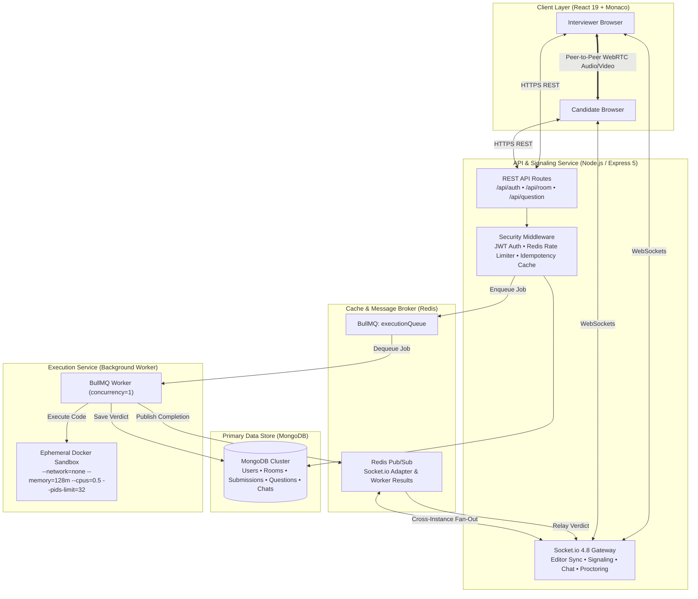

# 🌉 CodeBridge

> **A real-time technical interview platform featuring sandboxed multi-language code execution, low-latency WebRTC peer-to-peer video/audio, collaborative Monaco editor synchronization, and observable proctoring signal monitoring.**

[](https://nodejs.org)
[](https://react.dev)
[](https://expressjs.com)
[](https://socket.io)
[](https://redis.io)
[](https://www.mongodb.com)
[](https://www.docker.com)
[](server/package.json)

---

## Overview

Live technical interviews require real-time collaboration alongside secure, resource-controlled code evaluation. Running untrusted candidate code directly on application servers risks system compromise, infinite loops, and event-loop blocking that disrupts live video calls.

**CodeBridge** addresses this challenge by decoupling user-facing communication from untrusted code execution:
- **API & Signaling Service**: An Express and Socket.io gateway handling authentication, room management, and WebRTC signaling.
- **Execution Worker Service**: A dedicated background worker consuming jobs from a Redis-backed queue ([BullMQ](https://bullmq.io/)) and evaluating submissions in ephemeral, isolated Docker containers.
- **Frontend Workspace**: A React 19 single-page application providing a synchronized Monaco code editor, direct peer-to-peer WebRTC video, chat, and observable proctoring signal tracking.

> [!TIP]
> Preparing for technical interviews or reviewing system internals? See the comprehensive **[CodeBridge Technical Reference & Interview Preparation Guide](CodeBridge.md)** for complete architectural deep dives, detailed API references, database schemas, and codebase-specific interview question banks.

---

## Key Features

- **1-on-1 Collaborative Interview Rooms**: Create timed or open-ended rooms with 8-character unique IDs (`nanoid`), automatic candidate admission, and role assignments (`interviewer` vs. `candidate`).
- **Synchronized Monaco Code Editor**: Real-time syntax-highlighted code editor supporting **C++**, **Python**, **Java**, and **JavaScript** with automatic starter templates and peer synchronization.
- **Sandboxed Code Execution Engine**:
  - Code runs inside isolated Docker containers with `--network=none`, `--memory=128m`, `--cpus=0.5`, `--pids-limit=32`, and an immutable read-only root filesystem.
  - Fail-fast sequential testing providing rapid verdicts: Accepted (`AC`), Wrong Answer (`WA`), Time Limit Exceeded (`TLE`), Runtime Error (`RE`), and Compilation Error (`CE`).
  - Native Linux `ulimit` fallback runner for constrained hosting environments where Docker-in-Docker is unavailable.
- **Real-Time WebRTC Video & Audio**: Direct peer-to-peer audio, video, and screen-sharing using the browser's native `RTCPeerConnection` API and public STUN servers.
- **Persistent In-Room Chat**: Integrated messaging persisted to MongoDB with instant history delivery upon joining.
- **Observable Proctoring & Integrity Monitoring**: Detects fullscreen exits, tab switching, window blur, DevTools shortcuts, and large clipboard pastes. Persists anomaly logs to MongoDB and alerts interviewers in real time.
- **Question Bank & Bulk Ingestion**: Browse curated problem sets, create private questions, attach problems to specific rooms, or bulk-import questions via JSON with duplicate detection.
- **Dual-Token Authentication**: Secure HttpOnly access cookies paired with database-validated refresh tokens that support server-side revocation on logout, alongside GitHub OAuth 2.0.

---

## Architecture Overview



---

## Technology Stack

| Layer | Technologies | Key Responsibilities |
|---|---|---|
| **Frontend** | React 19, Vite 7, React Router 7, Monaco Editor, Tailwind CSS 4 | Single-page interview application, editor synchronization, WebRTC media rendering, proctoring listeners |
| **API & Sockets** | Node.js 20+, Express 5, Socket.io 4.8, `@socket.io/redis-adapter` | REST API routing, JWT authentication, real-time event broadcasting, horizontal Redis socket scaling |
| **Queue & Cache** | Redis 7, BullMQ 5, IORedis 5 | Background execution job queue, Pub/Sub event relaying, sliding-window rate limiting, SHA-256 idempotency caching |
| **Database** | MongoDB (Atlas or Local), Mongoose 9 | Persistent storage for users, rooms, submissions, questions, and chat history |
| **Execution Sandbox** | Docker Engine, Alpine Linux Compilers, Linux `ulimit` | Containerized code execution isolation, resource capping, watchdog timers, verdict computation |

---

## Getting Started

### Prerequisites

- **Node.js**: `v20.x` or higher
- **Docker Desktop**: Running locally (required for containerized code execution)
- **MongoDB**: Local instance (`mongodb://127.0.0.1:27017`) or free MongoDB Atlas connection string
- **Redis**: Local instance (`redis://127.0.0.1:6379`) or Upstash Redis database

### Quick Setup

1. **Clone the repository**:
   ```bash
   git clone https://github.com/avadhesh11/CodeBridge.git
   cd CodeBridge
   ```

2. **Install dependencies**:
   ```bash
   # Install API dependencies
   cd server && npm install

   # Install Execution Worker dependencies
   cd ../execution-service && npm install

   # Install Frontend dependencies
   cd ../Frontend && npm install
   ```

3. **Configure environment variables**:
   ```bash
   # In server/ directory
   cp .env.example .env

   # In execution-service/ directory
   cp .env.example .env
   ```
   *Edit `server/.env` and `execution-service/.env` to include your `MONGO_URI`, `REDIS_URL`, and JWT secrets.*

4. **Start all three services** (in separate terminal windows):
   ```bash
   # Terminal 1 — API Server (runs on http://localhost:5000)
   cd server && npm run dev

   # Terminal 2 — Execution Worker (listens on executionQueue)
   cd execution-service && npm run dev

   # Terminal 3 — Frontend SPA (runs on http://localhost:5173)
   cd Frontend && npm run dev
   ```

5. Open **http://localhost:5173** in your browser.

---

### Multi-Container Docker Compose

To launch the complete distributed stack (API, Worker, Frontend Nginx, MongoDB, Redis) with a single command:

```bash
docker compose up --build
```

| Service | Port Mapping | Description |
|---|---|---|
| `frontend` | `3000:80` | Production React SPA served via Nginx |
| `api` | `5000:5000` | Express REST API and Socket.io gateway |
| `worker` | Host Docker Socket | BullMQ worker executing isolated Docker containers |
| `mongo` | `27017:27017` | MongoDB database with persistent volume |
| `redis` | `6379:6379` | Redis broker for queues and pub/sub |

---

## Security & Execution Isolation

Executing arbitrary user code presents inherent security risks. CodeBridge applies defense-in-depth isolation mechanisms:

1. **Container Resource Constraints**: Every Docker execution is sandboxed with:
   - `--network=none`: Disables container network interfaces to prevent SSRF and external attacks.
   - `--memory=128m --memory-swap=128m`: Strict RAM limit with swap disabled; OOM attacks are terminated cleanly by the Linux kernel.
   - `--cpus=0.5`: Capped to half a CPU core via CFS quotas.
   - `--pids-limit=32`: Prevents process table exhaustion from fork bombs.
   - `--read-only --tmpfs /tmp`: Root filesystem is immutable; temporary scratch writes exist in RAM only.
   - `timeout -s 9 <seconds>`: Hard wall-clock watchdog issuing non-catchable `SIGKILL` signals against infinite loops.
2. **Buffer Bounds**: Stdout/stderr output is capped at 1 MB to prevent buffer overflow denial-of-service.
3. **Execution Rate Limiting**: Redis sliding-window limiter restricts submissions per user (1 request / 10s for sample runs; 1 request / 60s for hidden submissions).
4. **Idempotency Deduplication**: SHA-256 fingerprints of identical code submissions serve cached responses without triggering redundant container builds.

> [!WARNING]
> While Docker containers provide strong OS-level isolation, no sandboxing system is completely impenetrable against zero-day Linux kernel vulnerabilities or container breakout exploits. The native host execution fallback (`EXECUTION_RUNNER=native`) uses basic `ulimit` controls and lacks filesystem and network sandboxing; it should only be used in trusted development environments.

---

## Known Limitations

- **Full-Buffer Code Sync**: Code changes are transmitted as full text strings rather than Operational Transformation (OT) or CRDT deltas. Concurrent typing on the same line can result in last-write-wins overwrites.
- **In-Memory Room Timers**: Session timers (`roomTimers`) are stored in process-local memory. If an API server process restarts, active countdown timers are lost.
- **STUN-Only WebRTC**: WebRTC negotiation relies on public Google STUN servers. Clients behind strict corporate firewalls or symmetric NATs will fail to establish media streams without a configured TURN relay server.
- **Synchronous Polling**: The default `POST /api/room/codeTest` endpoint polls MongoDB every 1 second until the worker finishes, tying up HTTP server threads during long compilations. (An asynchronous mode is available via `?async=true`).

---

## Future Scope

- **Collaborative CRDTs**: Upgrading editor synchronization to Yjs or Automerge for concurrent multi-cursor pair programming.
- **Distributed Timers**: Moving room expiration scheduling from in-memory timeouts to BullMQ delayed jobs.
- **Managed TURN Relay**: Integrating a Coturn server with dynamic credentials to support enterprise firewall traversal.
- **Comprehensive End-to-End Testing**: Building automated Cypress or Playwright test suites covering multi-user WebRTC calls and editor sessions.

---

## License

This project is licensed under the [ISC License](server/package.json).

---

<div align="center">
  <sub>For in-depth architecture diagrams, complete API references, database schemas, and technical interview questions, see <strong><a href="CodeBridge.md">CodeBridge.md</a></strong>.</sub>
</div>
